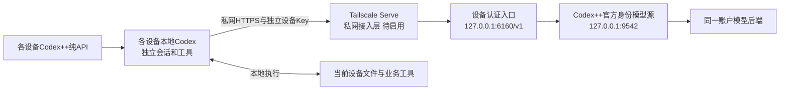
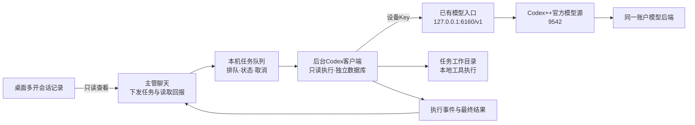

# Codex++ 多设备模型分发与任务协调方案

下文保留 2026-10-15 私网历史设计，不是当前控制台部署状态。新版 Windows 控制台试点见 [windows-pilot.md](windows-pilot.md)；模型与心跳接口必须使用管理员交付值，发布材料不能视为实际设备上线。

日期2026-10-15。本人少于20台Mac/Windows，先用一台Mac作主机、M6作跨设备试点。这是第三方实现和本机试验记录，不是官方容量承诺。

## 模型分发

模型源保存登录身份，设备只持自己的Key，以Responses调用，不逐一登录ChatGPT。已验证路径是单一官方身份helper直接转发，无需单成员聚合或Chat Completions转换。设备Key是私有入口认证，不是新增OpenAI计费API Key；设备数不增加账户额度。

Tailscale仅承载设备到模型入口的私网连接；模型源按主机既有线路访问上游。不要求设备全机流量经主机，也不以同一公网IP认定内网互通。业务工具权限与线路分别验收。

## 本机任务协调

当前仅本机、一个执行器、只读任务。主管可派发、读事件/结果、取消，桌面历史只读查看。跨设备领取、心跳、取消、回传与断电恢复需后续执行器。

## 状态

| 已验证 | 待完成 |
|---|---|
| Codex++1.8.0来源、校验、安装和隔离多开 | 其它Mac/Windows逐机兼容验收 |
| 本机认证入口、模型路径限制、完整Responses流式 | 私网HTTPS发布、第二台Key与端到端任务 |
| 本机真实工具读取、队列、取消与超时 | Windows执行器和跨设备协调 |
| 模型源/入口登录启动注册、受控退出/暂停恢复 | 实际重启恢复、长期续期、跨任务记忆 |
| 模型gpt-6.1-sol | 更多模型和2→5→少于20台容量验收 |

入口并发2、连接16、排队10秒为试点参数。受控退出后入口约16.45秒、源约14.15秒恢复，是当次实测，不保证固定时长或请求不中断。登录启动指当前用户登录后。

桌面实例有独立会话与数据库；后台每任务新上下文，队列保存指令、事件和结果。共享账号不自动共享主管聊天或ChatGPT记忆，AGENTS/wiki/历史结果需显式提供。

## 顺序

1. 主机实际重启恢复及长期续期。
2. 受限私网HTTPS、M6专用Key、错误Key与单台撤销。
3. M6受信远程登录、安装Skill、纯API多开、流式和本地工具验收。
4. Windows模板、逐机工具授权与回滚。
5. 队列常驻、租约、远程执行器及按负载扩容。

来源：[主项目1.8.0](https://github.com/BigPizzaV3/CodexPlusPlus/tree/v1.8.0)、[供应商导入](https://github.com/BigPizzaV3/CodexPlusPlus/blob/v1.8.0/crates/codex-plus-core/src/provider_import.rs)、[多开实现](https://github.com/BigPizzaV3/CodexPlusPlus/blob/v1.8.0/apps/codex-plus-manager/src-tauri/src/commands.rs)、[Tailscale Serve](https://tailscale.com/docs/features/tailscale-serve)及2026-10-13至15本机试点验收摘要。公开版不含实际设备地址或私有路径。
