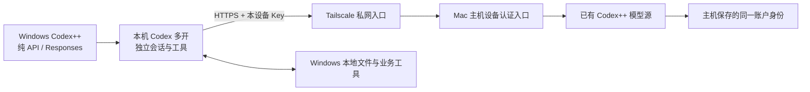

# Windows 设备 Codex++ 接入指南

版本：codex-device-relay-v0.1.1，2026-10-16。适用本人 Windows 客户端接入已有 Mac 主机模型源。本版以 Codex++ v1.8.0 的 Windows x64 安装包为基线；未完成 Windows 实机验收。新版官方桌面与旧版 Codex++ 的兼容性须在目标机核对，不能只凭安装成功判定可用。

## 1. 连接关系与每台需要的软件



每台 Windows 安装所需的官方桌面应用、Codex++ 与 Tailscale。Python 3.9 以上用于本包检测；CLI、Git、Node.js 按本地任务需要安装，CLI 不代替桌面应用。这里的“免登录”指客户端纯 API 模式不逐台登录 ChatGPT；Tailscale 入网和本地业务工具仍需各自授权。

模型和额度共用上游账户，Windows 文件、会话和工具在该设备本地。客户端不复制主机 OAuth、auth.json 或供应商数据库，也不自动读取主管会话或领取任务。客户端不需要另建官方身份模型源或 Chat Completions 转换。

## 2. 先收齐主机交付的信息

| 项目 | 填写规则 |
|---|---|
| 设备代号 | 每台不同，例如 win-01、win-02 |
| 私网 Base URL | 主机已实际发布并验证的 HTTPS 地址，包含 /v1；可能带端口 |
| 设备 Key | 主机为本台签发并登记的独立 Key，私下交付 |
| 模型名 | 主机实际模型目录中的名称，已有试点基线为 gpt-6.1-sol |
| 软件版本 | 记录 Windows 架构、官方桌面与 Codex++ 版本 |

只有示例地址或没有 Key 时，先完成软件与环境准备；模型验收保持待完成。Windows 中的 127.0.0.1 指 Windows 自己，不能填写主机的 127.0.0.1:6160。主机需按 [host.md](host.md) 完成私网 HTTPS 发布、访问规则与设备 Key；不因本指南发布而视为主机入口已启用。主机更换 Tailscale 节点或名称后，应重新交付实际 URL。

## 3. 安装与环境盘点

1. 保留现有工作窗口与模型入口，记录原供应商。以下命令在 Windows PowerShell 执行，不混用 WSL 路径和配置。
2. 若尚无官方桌面应用，从 [OpenAI Windows 官方文档](https://learn.chatgpt.com/docs/windows/windows-app) 安装当前受支持的应用；已有可用安装不强制更新。先让 Codex++ 检测并核对应用路径及兼容性。
3. 从 [BigPizzaV3/CodexPlusPlus v1.8.0 发布页](https://github.com/BigPizzaV3/CodexPlusPlus/releases/tag/v1.8.0) 下载 `CodexPlusPlus-1.8.0-windows-x64-setup.exe` 并安装。不要下载同名项目的安装包。本版发布的 Windows 包为 x64；ARM64 或 32 位设备另行核对，不声明已支持。
4. 从 [Tailscale Windows 官方说明](https://tailscale.com/docs/install/windows) 安装客户端，经托盘登录加入主机所在私网；在设备列表确认主机在线与访问授权。本次接入不需要启用出口节点、子网路由、全机代理或 Windows 的入站远程桌面服务。
5. 检测脚本需要 Python 3.9 以上；安装来源见 [Python Windows 文档](https://docs.python.org/3/using/windows.html)。先验证 `py -3 --version`；如果该机器只提供 `python`，核对版本后把后续 `py -3` 替换为 `python`。脚本仅使用标准库，不需要安装第三方 Python 包。

以下命令只盘点，不安装软件或改变网络：

```powershell
[System.Runtime.InteropServices.RuntimeInformation]::OSArchitecture
py -3 --version
Get-Command codex -ErrorAction SilentlyContinue
& "$env:ProgramFiles\Tailscale\tailscale.exe" status
```

Tailscale 非默认安装路径时使用实际路径。`codex` 未检测到只表示 CLI 不在 PATH，不证明桌面应用未安装。doctor 在 Windows 上不自动判定桌面与 Codex++ 安装位置，须结合开始菜单、已安装应用及 Codex++ 诊断确认。不要把检测的 null 当成通过。

本包以 Windows 原生执行环境为基线。WSL 的主目录、工具、认证与 Windows 原生环境不同；已有 WSL 用户须按实际执行环境单独核验，不自动把两边配置或数据库共用。

## 4. 交给本机 Codex 安装 Skill

如果 Windows 上已有可用的 Codex，可直接发送：

```text
请从 https://github.com/p1524607703-blip/agent-master/tree/codex-device-relay-v0.1.1
安装 .agents/skills/codex-device-relay 到当前 Windows 用户的 Codex Skill 目录。
读取并使用 $codex-device-relay，当前设备走 references/windows.md，并结合 client.md。
先做 doctor、安装与路径检查，保留正在工作的主管和现有模型入口。
使用 Codex++ 新增纯 API / Responses 单一供应商，另开独立实例。
主机实际 HTTPS Base URL、本设备 Key 的私有文件路径及模型名由我本机私下提供。
不要从 GitHub 找真实凭据，也不复制主机 OAuth 或替换全局 auth.json。
缺少 URL 或 Key 时完成不依赖它们的准备，保留待接入状态。
分别验收私网、设备认证、模型目录、完整流式、桌面多开、本地文件读取和撤销。
回执存仓库外；不能把脚本通过称为桌面工具通过。
```

默认用户级路径为 `%USERPROFILE%\.codex\skills\codex-device-relay`；已设置 CODEX_HOME 时应核对当前运行实例的实际主目录。仓库内则使用 `.agents\skills\codex-device-relay`。已有同名 Skill 先比较版本，保留必要备份。纯 API 多开启动后还需检查该隔离实例能否发现 Skill，不能假定主管的技能目录会自动共享；必要时把同一脱敏 Skill 安装到该实例实际使用的位置。

完全没有模型连接的新设备，先手动完成软件安装与第 5、6 节字段配置，或使用现有可用入口启动安装任务；尚不能调用模型的 Codex 无法自行完成首次接入。

## 5. 私网、Key 文件与基础检测

Key 文件放仓库外，例如 `%LOCALAPPDATA%\codex-device-relay\secrets\win-01.key`。由主机私下交付，以 UTF-8 无 BOM 保存一行，不加引号或空格；可用受信编辑器保存。Key 不输入聊天、URL 或命令参数。

在文件夹“属性 → 安全 → 高级”核对本目录及 Key 文件权限，按实际公司管理要求去掉其他普通用户/共享组的读取权限；保留当前用户与必要系统管理员访问。不在 OneDrive、公共目录、共享盘或 Git 仓库保存。下面的 Get-Acl 只显示权限，不显示 Key，也不会自动修改权限。

修改 Base URL 后运行，示例域名不能直接使用：

```powershell
$relayDeviceId = 'win-01'
$relayBaseUrl = 'https://relay.example.ts.net/v1'
$relayKeyFile = Join-Path $env:LOCALAPPDATA 'codex-device-relay\secrets\win-01.key'
$relaySkillRoot = Join-Path $env:USERPROFILE '.codex\skills\codex-device-relay'
$relayProbe = Join-Path $relaySkillRoot 'scripts\relay_device.py'
$relayUri = [Uri]$relayBaseUrl

Test-Path -LiteralPath $relayKeyFile
Get-Acl -LiteralPath $relayKeyFile | Format-List Owner, AccessToString
Resolve-DnsName -Name $relayUri.DnsSafeHost
Test-NetConnection -ComputerName $relayUri.DnsSafeHost -Port $relayUri.Port
py -3 $relayProbe doctor
py -3 $relayProbe probe --base-url $relayBaseUrl --device-id $relayDeviceId --key-file $relayKeyFile
```

若安装位置或 CODEX_HOME 不同，先把 relaySkillRoot 改为实际目录。认证探测的预期是：无 Key 401、错误 Key 401、正确 Key 的模型目录 200 且存在指定模型。此时不调用真实模型；TCP 可达也不能代替 HTTPS、认证或模型验收。

基础检测通过后，再执行一次真实流式请求：

```powershell
py -3 $relayProbe probe --base-url $relayBaseUrl --device-id $relayDeviceId --key-file $relayKeyFile --live
```

已交付的模型名与默认值不同时，两条 probe 命令都追加 `--model 实际模型名`。`--live` 只发一次模型请求，核对精确随机标记和 response.completed；不自动循环重试。脚本回执默认在 `%USERPROFILE%\.local\share\codex-device-relay\win-01\`，包含目录与流式状态，不含 Key。它仅对本进程忽略环境代理，不修改系统代理，也不跟随重定向或关闭证书验证。Windows Key 的 ACL 必须人工或用受信工具核对，脚本不自动判断 ACL 是否合适。

## 6. 在 Codex++ 配置单一供应商并多开

| 字段 | Windows 示例或要求 |
|---|---|
| 名称 | relay-win-01；后续每台用对应设备代号 |
| 模式 | 纯 API |
| 协议 | Responses |
| Base URL | 第 2 节主机实际发布的 HTTPS 地址，含 /v1 |
| Key | 当前设备独立网关 Key，直接在本机界面录入 |
| 模型 | 实际目录已验证的名称 |

保存后，从 Codex++ 的“Codex多开”选择此单一供应商启动。核对实际应用路径、隔离的配置与会话目录，保留当前主管；不通过关闭全部 Codex、重写默认 auth.json 或手工编辑 Codex++ 数据库实现切换。界面名以实际版本为准，缺少相应入口时先核对兼容性。

本路线使用第三方纯 API 接入，界面可能按 API 方式显示身份，不表示额度独立或后端没有账户。业务插件入口不保证与官方登录完全一致；钉钉、飞书、紫鸟等在 Windows 设备分别授权。无需在 Windows 开启“官方登录”或另建聚合供应商来获取主机模型。

## 7. 本地工具验收与批量推广

在 Windows 上建立独立测试目录和随机文件：

```powershell
$relayTestDir = Join-Path $env:LOCALAPPDATA ('codex-device-relay\tests\' + [Guid]::NewGuid().ToString('N'))
New-Item -ItemType Directory -Path $relayTestDir | Out-Null
$relayMarker = 'windows-relay-' + [Guid]::NewGuid().ToString('N')
[IO.File]::WriteAllText((Join-Path $relayTestDir 'probe.txt'), $relayMarker, [Text.UTF8Encoding]::new($false))
$relayTestDir
$relayMarker
```

在新多开窗口打开此目录，要求“使用本机文件工具读取 probe.txt，只返回文件内容”；核对真实工具调用和精确标记，再跟进一轮验证上下文。真实模型流式与本地工具是两项独立验收。测试文件随机标记可展示，设备 Key 不展示。

| 项目 | 通过条件 |
|---|---|
| 软件与私网 | 应用版本/路径可核对，Tailscale 入网且目标 HTTPS 可用 |
| 设备认证 | 无 Key、错 Key 拒绝；正确 Key 可列模型 |
| 完整流式 | 单次模型测试 200、准确标记、response.completed |
| 桌面多开 | 新实例可对话，原主管会话保留 |
| Windows 工具 | 新实例实际读取本机文件，后续一轮上下文正确 |
| 设备撤销 | 管理端撤销本设备 Key 后被拒绝，其他设备仍可用 |
| 回滚 | 关闭本次测试实例，可继续使用原供应商 |

当前 Windows 上述项目全部等待实测；本指南发布不改变验收状态。先以 win-01 试点，再逐台独立 Key 接入；2→5→少于20台递增并发，不同时把全部任务压入试点。已有入口并发 2、排队约 10 秒是试点配置，不代表账户支持 20 台同时执行。遇到 429 退避并减少并行任务，共享入口不增加额度。

## 8. Windows 常见问题

| 现象 | 下一步 |
|---|---|
| py / python 找不到或版本低 | 核对 Python 安装和实际解释器；新安装后新开 PowerShell |
| codex 找不到但桌面存在 | 分别确认 CLI 与桌面，不仅凭 PATH 下结论 |
| Key 文件明明存在却无效 | 核对 ACL、UTF-8 无 BOM、单行内容，以及是否由主机登记 |
| DNS 或 443/实际端口不通 | 核对 Tailscale、主机实际节点、访问规则和 Serve 发布状态 |
| 脚本能通但桌面不通 | 核对供应商保存值、多开实际加载的配置、应用自身网络与兼容性；脚本与桌面代理行为不同 |
| 401 / 404 | 区分网关 Key 与上游授权；检查 /v1 和模型路径 |
| 429 / 502 | 前者检查排队与额度；后者由主机检查模型源与上游连接 |
| 证书错误 | 修正域名、证书或系统时间，不使用跳过验证 |
| PowerShell 限制脚本执行 | 本文命令不要求更改全机执行策略；涉及额外安装脚本时按公司策略处理 |
| 纯 API 多开没有某个插件 | 在该设备及实例核对可用工具与授权，必要时单独配置 MCP，不复制主机凭据 |

## 来源与验收范围

- [Codex++ v1.8.0 README](https://github.com/BigPizzaV3/CodexPlusPlus/blob/v1.8.0/README.md)：安装、纯 API、Responses、多开与数据目录。
- [Codex++ v1.8.0 Releases](https://github.com/BigPizzaV3/CodexPlusPlus/releases/tag/v1.8.0)：Windows x64 setup.exe 和 zip 资产已核对。
- [OpenAI Windows 文档](https://learn.chatgpt.com/docs/windows/windows-app)：当前官方桌面安装与原生/WSL 环境说明；不构成对 Codex++ 的官方支持声明。
- [Tailscale Windows](https://tailscale.com/docs/install/windows)：Windows 客户端安装与入网。
- [Python Windows](https://docs.python.org/3/using/windows.html)、[Microsoft DNS 检测](https://learn.microsoft.com/en-us/powershell/module/dnsclient/resolve-dnsname)、[Microsoft TCP 检测](https://learn.microsoft.com/en-us/powershell/module/nettcpip/test-netconnection)、[Microsoft ACL 读取](https://learn.microsoft.com/en-us/powershell/module/microsoft.powershell.security/get-acl)。
- 本包既有 doctor/probe 实现：仅静态核对本指南与参数、路径、回执行为。Windows 原生 PowerShell、安装、多开、模型与业务工具均未在本次 Mac 编写环境实际运行。
