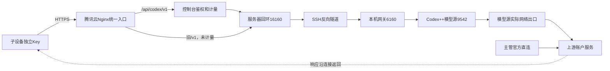
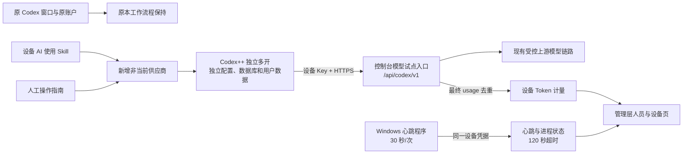

# Codex 人员、设备与用量接入

## rc.11 普通 API Key 接入（优先于下方 rc.10 必须安装连接器的旧说明）

普通模式直接使用已发布 HTTPS Base URL、独立 API Key 和 Responses API，无需设备连接器或自定义设备标识请求头。服务端只按 Key 的登记关系确定人员与设备归属，不采信客户端请求头指定的其他设备 ID。原管理员签发的 Key、归属和历史用量保留；本版显式迁移将既有登记设为普通 API 模式并记入迁移审计，撤销和停用仍生效。新建 Key 默认待审批，管理员在“接入审批与验证方式”批准后可用；取消批准阻止新请求，排队请求在实际调用上游前再次核对审批、撤销和人员状态。已开始的模型请求继续完成。

控制台可逐个切换“普通 API Key / 硬件绑定”。选择硬件模式后，除接入审批外仍要求已批准的设备公钥和每次请求签名；只有该模式需要 rc.10 连接器。普通模式不宣称能防止整套 Key 被复制到其他实体机器。验证方式与审批变更使用独立 revision 和数据库事务，记录操作者、时间及动作，不改原 Key、不清理历史用量，不扩大普通账号或管理层的现有后台权限。

鉴权失败明确区分：无效、撤销或失效人员 Key 返回401；待审批、停用和硬件证明错误返回带具体code的403。上游自身401/403转换为502 `upstream_authentication_failed`，防止误导客户端更换正确的设备Key。模型路由返回标准error对象；来源为access / relay / upstream，错误不泄露账户认证正文。

流式响应空闲时每15秒发送SSE注释保活，持续等待中的上游读取不会被保活计时取消。网关上游空闲读取默认660秒，控制台670秒，Nginx为900秒以覆盖120秒队列等待与670秒上游读取；保活不生成模型内容、不增加Token，也不把空闲时间当作已完成。完整流和工具历史沿原协议透传；截断、读超时和缺失最终事件明确失败，保存真实已观察usage，未知用量不填零。仅连接建立失败且尚未提交请求时至多重连一次；HTTP错误、已经提交的模型请求和已有部分输出均不自动重放。

并发、排队、公平分配与Retry-After沿原控制机制生效；不把普通Key接入变成绕过名额控制的白名单，也不擅自修改已有总／单台上限。上游真实429保留其状态和重试指导，不能通过中转扩大账户额度。源主机监督程序对进程探测超时保留未知状态，不把它当模型源死亡；状态文件写入失败不再终止健康源，连续健康失败才恢复，不触碰主管窗口及登录。

发布：先由数据库所有者执行 `backend/migrations/20261023_codex_api_access.sql`，只新增接入策略与审计表，可幂等执行。按固定Git版本prepare/deploy，并使用expected-current防止覆盖其他人的发布。在已接受请求排空后，仅替换网关与监督脚本；保持私有Key、连接地址和模型源授权。公开旧 `/v1` 仍保持关闭，不恢复绕过控制台审批和计量的路径。源码脚本为 `deploy/codex_gateway.py`、`deploy/codex_source_supervisor.py`，私有配置和认证不进入仓库。

验收须分别确认原Key、审批取消／恢复、停用、撤销、硬件可选、真实SSE及非流式Doctor、并发与用量去重。服务器验证不等于Windows桌面已验收；短请求成功不能承诺所有大上下文请求或外部上游永不超时。

### 新旧压缩请求兼容

现场真实请求确认，模型源原生 v2 `compaction_trigger` 经 `/responses` 正常完成，而其旧 `/responses/compact` 上游路径返回404。控制台将客户端的旧压缩请求一次转换成原生 v2 请求，按 `output_index` 保留完整结果窗口与上游原有 `encrypted_content`，返回 JSON `response.compaction`。原生 v2 请求继续直接透传。缺少原生压缩项、纯文本摘要、伪装为加密内容的本地摘要或截断响应明确失败；不拼造加密状态、不重放请求，用量沿同一 Key 记一次。压缩结果须原样传入下一轮，不能只截取压缩项；格式依据 [OpenAI Docs](https://developers.openai.com/api/docs/guides/compaction)。

## rc.11 主机模型源等待修复

现场进一步确认：原 Codex++ v1.8 模型源把流式响应头等待固定为120秒，网关更长的读取时间无法覆盖这一内层截止。主机专用 source worker 复用固定上游源码 `9a581df9394b6fb9340beb5453862e202079298b` 的 launcher、协议转换和既有授权读取流程；仅将流式响应头等待改成私有进程配置 `CPO_SOURCE_HEADER_TIMEOUT_SECONDS`（60–900秒，当前主机600秒），不改变普通非流式请求的原30秒策略。不复制、导出或重置OAuth，不改原主管窗口与登录。

worker移除外层“单次CDP探测失败就退出”的循环，由已验证进程身份的监督程序判断持续故障；仅连接建立失败且请求尚未送达时短暂重连一次。构建脚本从固定Git archive导出公开源码、核对待修函数，再编译无管理器窗口的worker并执行无模型自检。源码、修补过程、Cargo锁文件及原项目AGPL授权来源一并提供，构建缓存可在安装后清理。

模型源更新使用服务端私有、最长120秒自动过期的维护标记：正在执行的请求继续完成，新模型请求在已有公平队列中等待，审批、撤销和原并发参数不变。没有修改任一成员的Key或伪造活跃/Token事件。只在活动请求排空后替换worker；确认健康后立即移除标记。若维护失败则恢复上一模型源并清理自己的标记，避免长期卡住新请求。上游真实不可用或超出新等待上限仍如实失败，不重放已经提交的模型任务。

## rc.10 设备绑定接入（优先于下方旧版直接填Key流程）

新旧设备Key都必须通过硬件连接器与管理员指纹批准。仅HTTPS+Key已不能调用模型，旧公网/v1关闭。控制台“设备绑定”提供公开安装包，客户端从本机私有provider.txt新增非当前供应商并独立多开，原Codex保留。完整步骤与验证边界见[Codex设备密钥绑定](Codex设备密钥绑定.md)。

## 控制台启停与并发设置

“分发人员 & 设备 → 设备启停与并发”提供单台滑块开关、勾选批量启停和全部启停，作用于此 HTTPS 入口已登记的子设备。停用可恢复，原 Key 和用量历史保留；撤销仍不可恢复，全部启用不会复活已撤销 Key。全部操作覆盖操作时已登记且未撤销的子设备，创建新 Key 默认启用。主设备官方直连及旧 `/v1` 路径不受此入口控制。

设备总并发、每台设备并发均支持“无限”或 1–100000 的自定义整数；默认总上限 6，单台无限。两级上限同时生效；无限取消该级应用限制，不增加上游容量。达到上限的请求最多排队 120 秒、最多 24 个；被单台上限挡住的设备不会阻塞其他可运行设备。降低上限或停用设备时，正在执行的请求继续完成，排队请求会重新核对设置。停用设备返回 403 `device_disabled`，排队超限返回 429 并附带重试提示。

设置接口仅管理层／超级管理员可用：`GET/PATCH /api/codex/access-control`、`PATCH /api/codex/devices/{uuid}/control`、`POST /api/codex/devices/status`。变更必须携带读取时的 revision；过期修改返回 409，避免管理员相互覆盖。批量 ID 全部验证通过后原子保存，不允许部分生效。设备启停既在鉴权时核对，也在排队转执行前复查；客户端无法自行覆盖归属或开关。

私有策略持久保存在 `CODEX_EVENT_SPOOL_DIR/control/policy.json`（600），含修订号、最近修改人及时间，不含 Key、输入或输出，无数据库结构迁移。请求名额由同目录独立文件锁持有，覆盖多个工作进程，进程退出后自动释放；失败、断开与取消也释放名额。策略损坏返回明确不可用，不能静默重置启停设置。

上线顺序：先发布支持控制的控制台版本，默认策略保持现有总上限 6；再从同一固定 Git 版本升级本机网关，将私有 `externallyManagedDevices` 设为服务端专用入口凭据对应的登记名称，并设 `maxConnections=null`。只有该私有凭据免除重复的网关并发限制，实际总／单台限制由控制台持有；其他旧入口继续按原网关参数处理。始终回环监听，不改变模型源、主管或设备 Key。不能仅在 UI 显示无限而保留固定的 6 路网关限制。控制策略启用后若回退至不支持该策略的旧版本，旧代码不会执行启停控制，须作为独立回退风险处理。

## 多窗口 429 与网关排队

2026-10-22 的 YE 现场：8 次 429 均在约 10.2 秒后返回，同期本机网关向模型源发出的请求没有 429。现有网关的全局并发上限为 2，等待 10 秒后返回 `Local relay is busy`；全部人员的控制台请求共用这个上限。因此不能仅凭客户端 `Too Many Requests` 推断为上游 TPM/RPM 或用完额度，更换设备 Key 也不会扩大该上限。

可审阅网关源码位于 `deploy/codex_gateway.py`，源主机服务仍只监听回环，凭据沿用原私有配置。当前试点参数为 `maxConcurrent=6`、`maxQueued=24`、`queueWaitSeconds=120`、`maxConnections=32`，至少为健康检查保留两个连接。排队按先后顺序执行，不自动重发已经提交的模型请求；队列满或等待超时明确返回 `relay_queue_full` / `relay_queue_timeout`，携带 `Retry-After` 和 `X-Relay-Limit-Origin: local`。真正的模型源 429 保持原错误与重试时间，并标记 `upstream`。控制台转发这两个经过长度和字符校验的响应头，Token 计量仍只采信真实 usage。

升级时先提交并发布固定 Git 版本，从该版本安装网关脚本；私有备份现有脚本和配置，仅修改上述容量参数，在当前请求排空后单独重启网关。不要重启模型源或主管窗口，不修改任何账户认证与设备 Key。脚本、容量参数、进程和真实模型验收分别记录在仓库外。提高本地并发上限不能增加上游额度；超过已验收规模须依据实际模型源容量另行规划。

## 统一 API Key 分发与 Codex++ 内置联通测试

管理层可在“分发人员 & 设备 → API 接入与密钥”选择人员、填写接入名称和系统，创建独立API Key；同一HTTPS Base URL和模型用于全部接入。创建后仅在当前弹窗显示一次完整Key，可复制Key和地址，关闭后无法再次查看。列表只展示名称、归属和状态；支持改名与撤销。改名不变更Key、人员或历史用量，撤销阻止新请求且保留历史。新Key使用`sk-cpo-`前缀，已有YE/XT及其他已登记Key继续有效；数据库仍只保存哈希，未新增表或扩展普通人员权限。

私有后端配置`CODEX_PUBLIC_BASE_URL`指定已部署并通过TLS验证的HTTPS地址，包含`/api/codex/v1`。接口不根据请求Host头生成Key交付地址；修改域名须先完成真实DNS、TLS和路由验收。`GET /api/codex/access-config`与创建、改名、撤销接口仅管理层/超级管理员可用。

Responses入口支持字符串input和输入项数组，支持普通JSON响应与原有流式响应。普通请求在服务器转换为当前上游所需的数组input、`stream=true`及`store=false`，等待真正的最终模型响应后返回JSON；保留模型、`max_output_tokens`、工具、指令、推理等其他参数，成功、失败及未知用量仍由真实响应计量。不支持持久保存响应，因此显式`store=true`会返回明确错误。

Codex++内置Provider Doctor的原始请求`{"model":"...","input":"hi","max_output_tokens":16}`可直接使用现有HTTPS地址和设备Key，无需客户端额外脚本。不会用固定成功报文替代模型请求；上游拒绝、流中断或未收到最终响应继续返回失败。该兼容覆盖Responses接入，不新增Chat Completions、文件上传或其他未实现的OpenAI接口。

## 当前设备使用状态：由服务器请求判断

设备页不再依赖客户端心跳显示使用状态。服务器按独立设备Key绑定人员与设备，响应结束后继续从上游最终usage记录输入、输出、缓存及总Token；未知用量仍单列，历史账目不变。

- `activityStatus=active`：服务器仍在处理该设备请求，页面显示“正在使用”及并发请求数。
- `recent`：最近5分钟有请求，显示“最近活跃”。
- `idle`：显示“暂无近期请求”和最后使用时间，不把没有请求解释为电脑关机。
- `unknown`：读取失败、采集失效或页面数据过期时显示“状态待确认”；撤销设备显示“已停用”。

使用状态不需要Windows额外常驻程序；重启后使用原设备Key发请求即可。独立Key是归属依据，不是物理硬件认证，共用Key无法区分电脑。主设备直连不经过设备网关，继续按已有本机采集中的模型用量事件判断最近活跃，采集过期时不显示活跃。

进行中请求通过服务器持有的文件锁确认，覆盖首Token前等待和长时间流式响应；进程崩溃或重启后锁由操作系统释放，遗留文件不冒充进行中请求。最近使用时间合并请求记录与短期活动日志，数据库结构及用量计算不变。接口新增`activityStatus`、`activeRequests`、`lastActivityAt`与`activityRecentSeconds=300`；`online`兼容字段表示正在使用或最近活跃，旧`agentOnline`及心跳时间仅保留作诊断。

页面每15秒刷新，按服务器时间计算5分钟边界；刷新失败或超过45秒未更新时取消活跃显示。完成发布后旧标签页需完整重新加载，页面内“刷新状态”只更新数据。下文中的5分钟测试心跳及120秒在线规则属于旧版设备存在性检测，不再决定设备页的使用状态。

## 当前生产与候选版

rc.3已发布官方账户额度修正，保留设备具体Token。rc.4为统一入口账本候选：明确起点，逐来源列输入/输出/缓存/推理与未知用量、待补账。分母包含本期全部登记来源，包括停用设备及非活跃人员，不随搜索改变；官方账户总Token未核实时仍不计算账户占比。

## rc.4.2累计占比显示修正

rc.4.1本期账本从激活起点统计，起点之前的已记录消耗不会显示本期占比。rc.4.2新增recordedHistory，与原ledger同一只读事务/截止时刻读取全入口已有历史；独立首次记录时间，不重置CODEX_LEDGER_STARTED_AT，不回填未采集流量。包含停用设备和非活跃人员，不随搜索改变。

成员卡和左侧默认显示“占入口累计已计量”，分子、分母均来自recordedHistory，保留原具体Token。账本可切“入口累计”和“启用后本期”，后者无新请求会明确提示。官方账户Token总量仍未取得，不再把不可计算的账户占比放在成员主卡片。示例279,566÷688,610=40.6%，不是除以今日469,345或空的本期账本。

已打开的旧页面只刷新API数据不会更新JS；部署后须完整重新载入页面（必要时强制刷新）。后端/version.json和新编译资源须同版本核对；不能将截图缺少新版区域直接定性为后端漏数据。

## 统一入口账本rc.4

正式激活时，在私有backend.env设置CODEX_LEDGER_STARTED_AT为该次实际激活时刻的带时区ISO时间，并核验overview.ledger.startedAt一致。起点固定保存，后续发布不得自动重置；未设置、无时区或未来起点均不显示有效账本占比。区间为finished_at大于等于起点、小于等于throughAt，UTC计算。历史累计保留，未采集不填0；不改表结构；需由schema所有者显式执行backend/migrations/20261020_codex_ledger_usage_grant.sql，只授予6个用量/完成状态列UPDATE，不允许修改设备归属、响应ID或时间。发布脚本不自动执行该SQL。

ledger.scope=unified-entry，accountCoverage=partial。全账户Token保持null，入口占比即使相加100%也不表示官方账户全部消耗。未知请求不算0，待补账入库后才纳入；缓存、推理是父计数子集，不重复累加，缺失明细另计次数。主管直连、旧/v1和其他官方客户端未覆盖。管理员使用成员Key的历史验收仍归该成员；需专用来源Key才能区分，不能猜测重分类。

同一request_id/response_id去重；同设备未知响应随后返回有效usage时只补充一次，不改原发生时间、已知用量或跨设备归属。客户端断开或流异常保留已观察到的合法usage，缺失则未知。SSE最终data行无换行仍读取；不存储提示词、输出或认证正文。待补账失败不挡住已提交账本读取。

### 请求链路与出口



Nginx公网地址、设备内网地址和模型源实际出口是三个不同概念。统一入口不表示所有请求都已覆盖，旧/v1仍绕过控制台。官方允许本人多设备，禁止将个人账号提供给他人；统一IP不会改变授权范围，也不保证不封号。来源：[账号共享政策](https://help.openai.com/en/articles/10471989-openai-account-sharing-policy)、[使用条款](https://openai.com/policies/terms-of-use/)。

### 迁移顺序与验收

1. 发布账本并固定起点，现有/api/codex/v1子设备继续使用原Key，无需换包。
2. 主管独立试点、管理员测试应分别登记专用来源Key，先新增非当前供应商并独立多开；验收单次usage、归属和本期分母，再决定主管迁移。执行当前任务时不覆盖主管认证或全局重启。
3. 旧/v1设备逐台改用各自新入口并实机验收；无法由HTTP请求日志补造历史Token。确认无人使用后再单独批准撤销旧入口。
4. 各目标设备通过可用操作通道完成迁移；服务器探测不等于Windows桌面已配置。其他官方客户端、历史缺失及未返回usage继续列为未覆盖/未知。
5. 团队成员使用需确认上游具有成员授权；个人订阅不是团队共享许可。此账本可沿用到合法授权的团队上游，不以统一IP代替授权。

试点保留现有 M4 模型测试节点与腾讯云入口，未来日本生产迁移仍是独立任务。不是为了此次试点更换上游账户授权，也不复制主账户 OAuth。给新的成员服务前，管理员须确认上游允许的成员使用方式；个人订阅登录身份和设备 Key 是两类凭据。

## v0.2 独立多开试点



Skill 位于仓库 `.agents/skills/codex-device-relay/`；人工版在该 Skill 的 `references/windows-pilot.md`。私有设备包包含这两种入口、连接配置及测试程序，不含管理员/模型源登录令牌。试点只新增非当前供应商并从「Codex多开」启动，不使用会改变默认选中项的原生待确认导入，不点新供应商「设为当前」或全局「重启 Codex」。停止时仅结束试点实例与心跳，原窗口保留。

### 部署前需要准备的实际配置

- 明确发布指定候选 commit；按既有《开发提交与上线流程》先 prepare，收到发布确认后再 deploy。
- 单独执行 `backend/migrations/20261018_codex_device_telemetry.sql`：只新增 `codex_ops.devices` 与 `codex_ops.model_requests`，外键引用已有 iam 人员；不更改用户密码、角色、名册、广告事实表。
- 私有后端配置启用 `CODEX_TELEMETRY_ENABLED=true`，设置 `CODEX_UPSTREAM_BASE_URL`、`CODEX_UPSTREAM_KEY_FILE`、`CODEX_EVENT_SPOOL_DIR` 和 `CODEX_DEPLOYMENT_TARGET`。上游 Key 是服务端专用模型入口凭据，文件 600、目录 700；不放客户端包或 Git。
- 本次服务端上游可为现有 SSH 回环入口 `http://127.0.0.1:16160/v1`；HTTP 只允许回环，非回环必须 HTTPS。子设备使用受信 HTTPS 地址，Base URL 以实际交付为准。
- 在现有 Nginx server 中为 `/api/codex/v1/responses` 与 `/api/codex/v1/responses/compact` 各加一个 exact location，include 本候选的 `deploy/infra/codex-model-proxy.conf`；语法检查后平滑重载。不能整份覆盖已有 server，保留原模型及控制台路由。
- 私有设备登记清单由管理员绑定真实人员ID和随机 Key。激活时在候选 backend 下运行 `scripts/register_codex_device.py --manifest-file /private/device-manifest.json`；标准输出不包含 Key。重复导入相同清单幂等，换人或换 Key 会冲突，不擅自覆盖。
- 客户端 `device.json` 只含本设备 UUID、标签、连接参数与设备 Key，不携带管理层会话或主账户 OAuth。未激活返回404/503时客户端只准备，不宣称已安装连接。

### 接口、授权与计量

`GET /api/codex/overview`、`POST /api/codex/devices` 和 `DELETE /api/codex/devices/{uuid}` 仅管理层/超级管理员可用。创建设备只返回一次 Key；数据库只存 SHA256。`POST /api/codex/heartbeat` 与 `/api/codex/v1/*` 按设备 Key 认证，并检查绑定人员仍 active、设备未撤销。心跳不能指定或伪造人员ID、设备ID和 Token 数，客户端没有用量上报接口。撤销后拒绝新调用及心跳，不强制中断已经发出的模型任务。

计量从服务端收到的 `response.completed` 等最终响应中读取 usage；非流式/compact 读取最终 JSON。仅保存响应ID、设备ID、时间、状态和 Token 字段，不保存输入、输出正文或认证头。Token 缺失或非法记为未计量；缓存/推理属于输入/输出子集，不能额外相加。同一响应ID全局去重，避免同一次响应被重试重复累计；唯一请求ID防止 outbox 重放重复入库。请求失败或中断不能因为HTTP头为200就冒充完成。无效 usage、上游错误或连接失败应独立记录未计量，而非零消耗。

完成事件先写到服务端私有 outbox 后入库；数据库暂时不可用时保留待重放文件，管理端读取会重放一批。设备页在数据读取失败或过期时停止显示绿点；DB 和 outbox 是不同持久层，回滚不删除它们。磁盘错误或长期数据库故障须按监控处理，不能声称无限可靠计量。Token 是模型返回的实际计量，不是 Pro 剩余额度、计费金额或用户活跃工时。

在线依赖服务端接收的心跳时间与报告的 Codex/ChatGPT 进程存在性。模型目录或模型请求不更新在线状态；后台进程存在不证明真人在线或指定聊天正在执行。客户端测试心跳默认只运行5分钟，不设开机任务。停止后超过120秒应离线。

### 官方额度、设备Token与总量口径

管理接口GET /api/codex/account-quota及overview.accountQuota只返回经过字段白名单处理的官方额度快照。主模型源通过官方app-server的account/rateLimits/read获取5小时/每周usedPercent，服务端计算remainingPercent=100-usedPercent，并显示重置时间与采集时间。不能从原始Token或团队小计反推套餐总容量。

控制台保留成员具体Token数。全账户Token分母须独立验证；当前accountTotalTokens=null、tokenTotalScope=unverified，因此不计算设备占账户总量，不把两设备归一成100%。本地account/usage/read实测在空SQLite目录返回0，换为同一账号的主会话库副本后返回不同累计值，未验证为跨设备完整账目，不用作账户总分母。不根据官方配额百分比强行分摊成员配额成本。

新增配置CODEX_QUOTA_SNAPSHOT_FILE指向服务器私有JSON文件。快照schemaVersion=1，仅含status、capturedAt、primary/secondary的usedPercent/windowDurationMins/resetsAt及planType；服务端不接收或返回OAuth。文件必须私有且小于32KiB，超过5分钟、格式异常或采集失败时显示不可用/过期，不保留旧数字冒充实时。

源主机采集脚本scripts/collect_codex_quota.py读取私有配置（600），字段codexExecutable、codexHome、expectedAccountDigest、localSnapshot、remoteSnapshot和sshHost。脚本用独立临时SQLite目录读取官方限额，核对源accountId的SHA256，仅用现有受信SSH发送白名单快照，不发送账户认证文件。--once做一次核验，常驻模式每120秒读取，锁防重复进程；主源或当前会话不重启。正式启用后台组件及后端文件路径须在候选明确发布时配置，不把一次成功采集称为已常驻。

device agentOnline表示最近120秒内真实心跳；codexRunning单独显示客户端运行状态，不依赖是否对话。旧5分钟程序保留作测试，新Windows包可用4开启当前用户登录启动的持续心跳，5停止本次心跳、6移除登录启动；不能把Mac测试称为Windows原生验收。客户端不持管理层会话、无授权审批权限，也不上传Token计数。

### 管理员授权接口的实现边界

当前已上线设备Key注册/撤销、心跳和模型认证。另一路成员授权、Key签发/轮换与审计代码位于独立开发分支，尚未部署；不能把代码存在等同接口上线。当前没有完整的设备申请-管理员批准-设备领取结果的注册回传闭环，也没有设备命令执行的管理员远程审批通道。这两种需求须先明确，不能用设备心跳或管理层登录冒充审批回传。

### 验收与回滚

隔离测试命令（仅临时 Unix socket PostgreSQL，无 TCP 监听）：

```bash
python backend/scripts/test_codex_isolated.py --pg-bin /path/to/postgresql/bin
```

显式 `--live-key-file`、`--live-base-url`、`--receipt-file` 选项仅在已获模型调用授权时使用；会发一次真实请求，用临时合成人员身份验证计量，不能算作实际 Windows 或 XT 已上线。真实用量与测试身份回执留在仓库外。

实际 Windows 验收须分别核对：主窗口保留及配置未被接入流程改写、独立多开目录、模型目录与真实流式、随机本地文件读取、两轮上下文、控制台计量匹配、真实心跳变在线、停止后超过120秒离线、单台撤销与其它设备保持可用。M4上或模拟心跳的通过不能代替这些验收。

回滚先停止本试点实例和心跳，禁用试点功能；按批准的旧 commit 回滚控制台并只移除试点 Nginx exact locations。保留数据库记录与 outbox，暂不撤销其他设备或删除已有登录文件。恢复原窗口不依赖本试点 Key 或服务器可达。

## 原筹备阶段记录

管理层及超级管理员访问 `/codex-devices`。左侧按运营组 / AI 小组展示18名分发人员，右侧预留设备状态、今日及累计 Token。模块和导航入口使用圆角边框，灰点表示离线或尚未接入，绿点仅在后续获得有效设备心跳后显示。

当前仅接入 `amazon_ads.codex_ops.personnel_roster` 的真实人员名单；设备、在线和用量均明确显示待接入，不生成测试消耗或在线记录。完整名单只对管理层开放，普通运营和AI账号不增加CPO业务权限。服务端以只读事务查询应用库，无模型请求、设备注册、心跳采集或Token写入接口。

最终 Codex 主账户将统一部署至日本代理服务器，随后再实施分发和实际计量。公司 M4 只是代理测试节点，不能作为最终生产主账户位置。当前版本不修改现有腾讯云与M4的模型代理链路。

后续接入需绑定独立设备ID与人员ID，在代理最终响应中记录实际Token并按响应ID去重，设备通过心跳确定在线状态；缓存和推理Token属于父计数子集，避免重复累加。暂定30秒心跳、120秒超时，届时根据部署情况确认。


## Pro 套餐窗口兼容修正 rc.4.3

官方已说明 Pro 当前没有五小时限制，仍须按账户实时返回的额度窗口和重置时间展示。不能固定认为 primary 是五小时、secondary 是每周：本次实测升级后每周窗口在 primary，secondary 为 null，采集状态仍为 available。

页面按 windowDurationMins 动态命名并只展示实际窗口，另列采集状态；缺失窗口、读取失败、过期分别处理。现有120秒采集、300秒过期、源账户身份校验继续保留，不以关闭校验处理套餐升级。超过有效期不保留旧百分比，不将未返回窗口补成0%或无限额度。

官方额度百分比、入口已计量Token占比、订阅账单是三种不同口径；API价目不能反推个人Pro订阅的实际费用或总Token容量。本修正不新增账单采集、不更改已有Token账本起点或凭据。

参考：[官方定价与额度](https://learn.chatgpt.com/docs/pricing)、[账户额度接口](https://learn.chatgpt.com/docs/app-server#account-endpoints)。升级后完整刷新页面，Mac使用⌘⇧R，Windows使用Ctrl+F5。


## 业务预热修复与整合候选 rc.4.4

rc.4.3第一次发布因CPO完整日期查询超过30秒自动回退。确认客户端退出后同一只读SQL仍在数据库运行数分钟，放大并发压力。rc.4.4保留rc.4.3窗口显示，完整日期改为从业务数据日期边界生成候选日，对各账户通过现有索引读取首条有效报告；仍要求所有业务账户在同一子报告或父日报告来源齐全，且四广告账户的推广/转化报告都有正确目标表的批次。缺失不补齐、重复不增算，不改变统计日期与业务分母。

两条psql查询通道增加会话级28秒statement_timeout，早于原30秒客户端截止，避免客户端消失后继续查询；保留其他连接选项，不修改数据库全局设置、表数据或导入任务。独立PostgreSQL回归验证随机75天缺失/重复/错批次/日期边界，以及真实pg_sleep被两条通道取消后无活动残留。线上仍以标准发布的日/月预热、版本与两库健康为验收；不跳过检查。

技术依据：[PostgreSQL会话查询超时](https://www.postgresql.org/docs/18/runtime-config-client.html#GUC-STATEMENT-TIMEOUT)。


## rc.5 账户总额度归属与潘锦龙主设备

本版按用户纠正的口径展示：本期官方账户总额度为100%，账户已用=已确认人员消耗+待归属，账户已用+剩余=100%。不再以设备Token小计为分母计算主界面人员百分比。用户明确确认的初始3个百分点全部归潘锦龙（既有人员user_id=17）主设备，其余人员无已确认归属为0%；后续官方已用上涨而未经确认的部分进入“待归属”，不按Token比例分摊。

确认记录保存在服务器私有JSON，通过windowDurationMins、resetsAt、planType精确绑定周期；换周期/套餐不沿用旧确认，同周期官方用量下调至已确认量以下时标记待复核，不造负数或强行归一。配置信息无效、额度采集失败或过期时不展示人员实时比例。管理接口权限不变。配置路径为CODEX_QUOTA_ATTRIBUTION_FILE，记录确认ID、人员ID、时间和额度百分点，密钥不写入。后续追加归属也须有明确来源确认，不自动猜测。

新增主设备为只读本机计量来源，不签发设备API Key，也不修改原官方登录。现有额度采集器每120秒同时读主CODEX_HOME的JSONL token_count事件，将同会话累计计数相减、跨文件重复事件去重；仅汇总本期Token、今日Token和运行状态，再经已有SSH送私有快照。日志缺失基线、计数回退和继承会话计数单列待核对，不把累计历史全算进本期。上传内容不含聊天正文、会话文件路径或OAuth。

主设备具体Token标为“本期本机已计量”，覆盖本机已有日志，按计量事件完成时间归期；输入中包含缓存，推理在输出内，不重复加到总Token。它不是官方账户全部Token，也不能用Token反推额度百分点。其他设备具体历史累计保留，另列本期Token；历史入口表折叠保留且去掉分摊比例。主设备在线须有新鲜采集并实际检测到主Codex进程；采集过期不显示在线。

服务器主设备快照路径CODEX_HOST_USAGE_SNAPSHOT_FILE；不改数据库结构、人员权限、已签发Key或原入口账本起点。页面底部显示“账户归属版rc.5”，首次默认选主设备；旧标签页须完整刷新。
