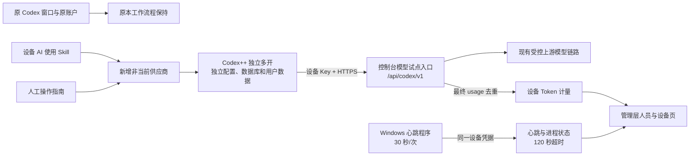

# Codex 人员、设备与用量接入

## 当前生产与候选版

当前生产人员页仍为筹备阶段。下文 v0.2 是待确认发布的设备试点：功能开关默认关闭，不在启动或发布脚本中自动执行 migration、登记设备、创建心跳或模型消耗。准备候选版不代表已接入 Windows。

试点保留现有 M4 模型测试节点与腾讯云入口，未来日本生产迁移仍是独立任务。不是为了此次试点更换上游账户授权，也不复制主账户 OAuth。给新的成员服务前，管理员须确认上游允许的成员使用方式；个人订阅登录身份和设备 Key 是两类凭据。

## v0.2 独立多开试点



Skill 位于仓库 `.agents/skills/codex-device-relay/`；人工版在该 Skill 的 `references/windows-pilot.md`。私有设备包包含这两种入口、连接配置及测试程序，不含管理员/模型源登录令牌。试点只新增非当前供应商并从「Codex多开」启动，不使用会改变默认选中项的原生待确认导入，不点新供应商「设为当前」或全局「重启 Codex」。停止时仅结束试点实例与心跳，原窗口保留。

### 部署前需要准备的实际配置

- 明确发布指定候选 commit；按既有《开发提交与上线流程》先 prepare，收到发布确认后再 deploy。
- 单独执行 `backend/migrations/20261018_codex_device_telemetry.sql`：只新增 `codex_ops.devices` 与 `codex_ops.model_requests`，外键引用已有 iam 人员；不更改用户密码、角色、名册、广告事实表。
- 私有后端配置启用 `CODEX_TELEMETRY_ENABLED=true`，设置 `CODEX_UPSTREAM_BASE_URL`、`CODEX_UPSTREAM_KEY_FILE`、`CODEX_EVENT_SPOOL_DIR` 和 `CODEX_DEPLOYMENT_TARGET`。上游 Key 是服务端专用模型入口凭据，文件 600、目录 700；不放客户端包或 Git。
- 本次服务端上游可为现有 SSH 回环入口 `http://127.0.0.1:16160/v1`；HTTP 只允许回环，非回环必须 HTTPS。子设备使用受信 HTTPS 地址，Base URL 以实际交付为准。
- 在现有 Nginx server 中为 `/api/codex/v1/responses` 与 `/api/codex/v1/responses/compact` 各加一个 exact location，include 本候选的 `deploy/infra/codex-model-proxy.conf`；语法检查后平滑重载。不能整份覆盖已有 server，保留原模型及控制台路由。
- 私有设备登记清单由管理员绑定真实人员ID和随机 Key。激活时在候选 backend 下运行 `scripts/register_codex_device.py --manifest-file /private/device-manifest.json`；标准输出不包含 Key。重复导入相同清单幂等，换人或换 Key 会冲突，不擅自覆盖。
- 客户端 `device.json` 只含本设备 UUID、标签、连接参数与设备 Key，不携带管理层会话或主账户 OAuth。未激活返回404/503时客户端只准备，不宣称已安装连接。

### 接口、授权与计量

`GET /api/codex/overview`、`POST /api/codex/devices` 和 `DELETE /api/codex/devices/{uuid}` 仅管理层/超级管理员可用。创建设备只返回一次 Key；数据库只存 SHA256。`POST /api/codex/heartbeat` 与 `/api/codex/v1/*` 按设备 Key 认证，并检查绑定人员仍 active、设备未撤销。心跳不能指定或伪造人员ID、设备ID和 Token 数，客户端没有用量上报接口。撤销后拒绝新调用及心跳，不强制中断已经发出的模型任务。

计量从服务端收到的 `response.completed` 等最终响应中读取 usage；非流式/compact 读取最终 JSON。仅保存响应ID、设备ID、时间、状态和 Token 字段，不保存输入、输出正文或认证头。Token 缺失或非法记为未计量；缓存/推理属于输入/输出子集，不能额外相加。同一响应ID全局去重，避免同一次响应被重试重复累计；唯一请求ID防止 outbox 重放重复入库。请求失败或中断不能因为HTTP头为200就冒充完成。无效 usage、上游错误或连接失败应独立记录未计量，而非零消耗。

完成事件先写到服务端私有 outbox 后入库；数据库暂时不可用时保留待重放文件，管理端读取会重放一批。设备页在数据读取失败或过期时停止显示绿点；DB 和 outbox 是不同持久层，回滚不删除它们。磁盘错误或长期数据库故障须按监控处理，不能声称无限可靠计量。Token 是模型返回的实际计量，不是 Pro 剩余额度、计费金额或用户活跃工时。

在线依赖服务端接收的心跳时间与报告的 Codex/ChatGPT 进程存在性。模型目录或模型请求不更新在线状态；后台进程存在不证明真人在线或指定聊天正在执行。客户端测试心跳默认只运行5分钟，不设开机任务。停止后超过120秒应离线。

### 验收与回滚

隔离测试命令（仅临时 Unix socket PostgreSQL，无 TCP 监听）：

```bash
python backend/scripts/test_codex_isolated.py --pg-bin /path/to/postgresql/bin
```

显式 `--live-key-file`、`--live-base-url`、`--receipt-file` 选项仅在已获模型调用授权时使用；会发一次真实请求，用临时合成人员身份验证计量，不能算作实际 Windows 或 XT 已上线。真实用量与测试身份回执留在仓库外。

实际 Windows 验收须分别核对：主窗口保留及配置未被接入流程改写、独立多开目录、模型目录与真实流式、随机本地文件读取、两轮上下文、控制台计量匹配、真实心跳变在线、停止后超过120秒离线、单台撤销与其它设备保持可用。M4上或模拟心跳的通过不能代替这些验收。

回滚先停止本试点实例和心跳，禁用试点功能；按批准的旧 commit 回滚控制台并只移除试点 Nginx exact locations。保留数据库记录与 outbox，暂不撤销其他设备或删除已有登录文件。恢复原窗口不依赖本试点 Key 或服务器可达。

## 原筹备阶段记录

管理层及超级管理员访问 `/codex-devices`。左侧按运营组 / AI 小组展示18名分发人员，右侧预留设备状态、今日及累计 Token。模块和导航入口使用圆角边框，灰点表示离线或尚未接入，绿点仅在后续获得有效设备心跳后显示。

当前仅接入 `amazon_ads.codex_ops.personnel_roster` 的真实人员名单；设备、在线和用量均明确显示待接入，不生成测试消耗或在线记录。完整名单只对管理层开放，普通运营和AI账号不增加CPO业务权限。服务端以只读事务查询应用库，无模型请求、设备注册、心跳采集或Token写入接口。

最终 Codex 主账户将统一部署至日本代理服务器，随后再实施分发和实际计量。公司 M4 只是代理测试节点，不能作为最终生产主账户位置。当前版本不修改现有腾讯云与M4的模型代理链路。

后续接入需绑定独立设备ID与人员ID，在代理最终响应中记录实际Token并按响应ID去重，设备通过心跳确定在线状态；缓存和推理Token属于父计数子集，避免重复累加。暂定30秒心跳、120秒超时，届时根据部署情况确认。
